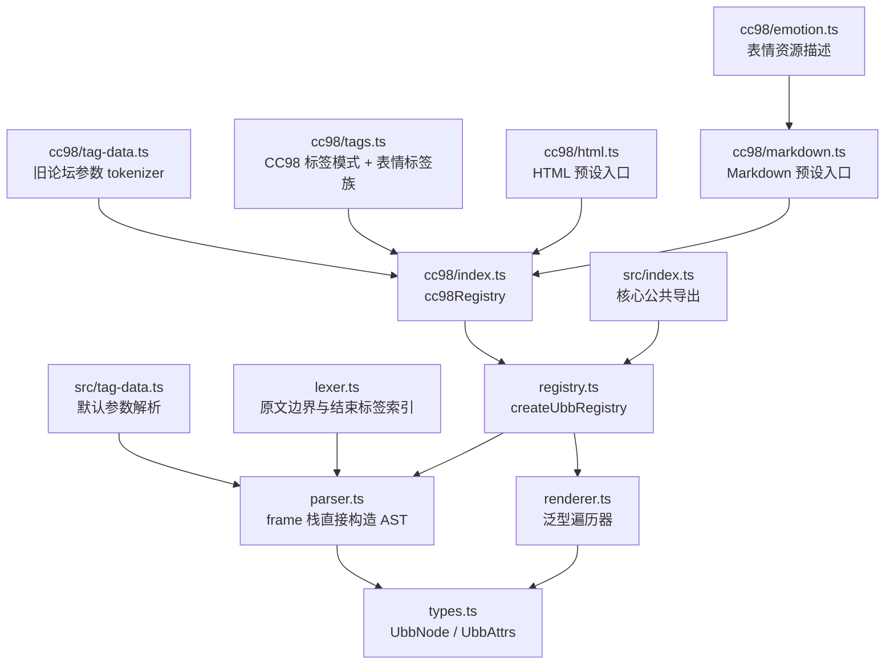
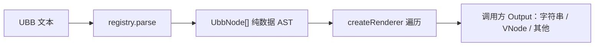

# ubb-core 架构

框架无关的 UBB 解析与输出工具。注册器指定标签和标签头参数解析方式，泛型 renderer 把 AST 转成调用方选择的输出类型。CC98 规则及其 HTML、Markdown 输出是显式预设。只读解析，不做编辑器。

## 模块布局

## 数据流

- 根入口不导出底层 `parseUbb`，解析只能经过注册器。`registry.parse` 使用注册器的精确标签、标签族和 `parseTag`：精确标签优先，未命中时按登记顺序匹配标签族。CC98 预设提供旧论坛参数 tokenizer、静态表与表情标签族。解析后的 AST 不含渲染信息，标签节点带开始、结束标签原文 `raw`，命中标签族的节点带 `family`。
- 遍历器按节点分派：文本节点走 `renderText()`，标签节点按 `family ?? tag` 查 handler，未命中走 `fallback`。handler 收到同一组参数：`node`、`attrs`、惰性渲染结果 `content`、纯文本 `textContent`、`context`、子树 `renderNodes(nodes)`。
- 公开的 `render(source)` 与 `renderNodes(nodes)` 在根输出完成后执行 `finalize`；handler 内的 `renderNodes(nodes)` 不重复执行。
- 根入口 `ubb-core` 只导出通用解析与泛型 renderer API；`ubb-core/cc98` 提供 CC98 解析规则和表情资源；字符串预设分别从 `ubb-core/cc98/html` 和 `ubb-core/cc98/markdown` 导入。

扫描器按需读取标签头，偏移始终来自原文；通用 registry 默认使用 literal 边界，CC98 使用 quoted。text 模式的结束索引增量推进，找到目标便暂停，失败余文不重扫。注册器预建标签 spec 和有序标签族数组。解析器用活跃同名 frame 链处理闭合，正常闭合复用内部节点和子数组，仅未闭合恢复通过显式栈展开；内部 Pending 不交付调用方。

正常闭合直接匹配栈顶，首次错配才建立活跃同名索引；结束标签直接切取名称，普通参数利用原生字符串搜索跳过内容。quoted 边界仍保留值中等号、空白、转义和未匹配引号的规则。

renderer 使用共享惰性 getter，每个 handler 参数独立保存缓存；renderNodes 函数首次读取才创建，支持解构和重入。默认最多 128 层标签调用，超限抛出 UbbRenderDepthError。网站捕获后用原始输入展示全文。纯文本提取为迭代遍历。
